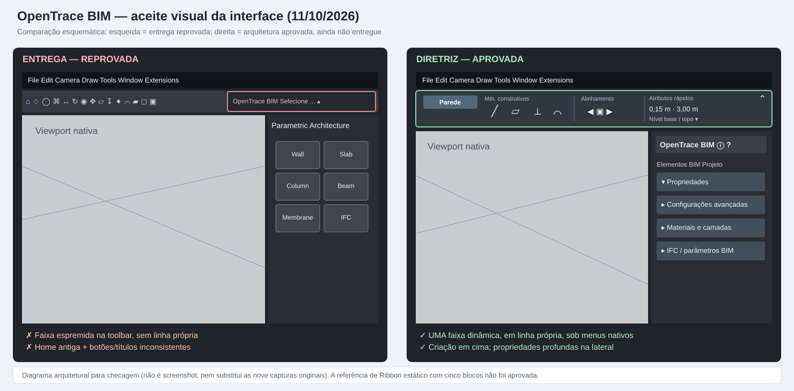

# OpenTrace BIM — Caderno mestre EXCLUSIVO da interface

**Registro:** 11/10/2026 · **Origem principal:** conversa **“Melhorias De Interface”** (09/10/2026), complementada pelas quatro capturas da conversa trazidas novamente em 11/10/2026 e pelo [caderno geral](DEVELOPMENT_MASTER.md).  
**Repositório:** [lelopes05/opentrace-bim](https://github.com/lelopes05/opentrace-bim) · **Branch de trabalho:** dev/opening-controller-integration-2026-10-10 · **PR:** [#8, experimental](https://github.com/lelopes05/opentrace-bim/pull/8).  
**Caráter deste documento:** especificação de **experiência e interface**, separada de geometria e motores BIM. É fonte de consulta obrigatória para qualquer alteração visual.

> **ACEITAÇÃO VISUAL REPROVADA EM 11/10/2026.** As primeiras três capturas do mantenedor mostram a Info Box comprimida na toolbar nativa, uma paleta lateral ainda intitulada “Parametric Architecture” e controles de alinhamento sem a hierarquia visual combinada. B3b/UI-2 e a reformulação da paleta lateral **NÃO ESTÃO CONCLUÍDOS**, mesmo com CI verde. Consultar o [comparativo visual documentado](assets/interface/comparacao-aceite-2026-10-11.svg) e o capítulo de auditoria ao fim deste caderno. A referência é uma barra CONTEXTUAL em faixa própria abaixo dos menus nativos do IngeTrazo, não um Ribbon fixo.

> **Limite documental importante:** o histórico recuperável da conversa original inclui decisões, trechos resumidos e mensagens datadas, **não uma transcrição integral verificável**. As quatro capturas fornecidas pelo mantenedor foram usadas para reconstruir diagramas e pormenores visíveis. Itens não comprovadamente aprovados aparecem como **proposta/pendente**, nunca como decisão ratificada. Esta versão não declara implementadas telas que só foram desenhadas.

## 0. Política de blocos da interface e ordem entre frentes (vigente em 11/10/2026)

**Autoridade cruzada:** o capítulo **“Plano executivo entre frentes — autoridade operacional (2026-10-11)”** em [DEVELOPMENT_MASTER.md](DEVELOPMENT_MASTER.md) define **a ordem obrigatória entre A (aberturas) e B (interface), os gates técnicos e o tamanho dos blocos**. Este capítulo especifica apenas **o corte de escopo e a aceitação visual de cada bloco B**; não cria um segundo cronograma divergente.

**Ordem da interface:** verificar e preservar B1/B2 e o código existente de B3a → **implementar B3b primeiro** como bloco visual completo → integrar B3a e a paleta ao resultado → B4 ajuda/Sobre → B5 aceitação real no Windows → etapas 05 e 06 no tempo definido pelo mestre geral. **B3b e A1 devem progredir paralelamente**; nenhum espera a aprovação manual do outro quando não há dependência de código. Fluxos que compartilham arquivos/callbacks de UI serão reconciliados sequencialmente.

| Bloco UI | Escopo mínimo que o torna um bloco substancial | Evidência e condição de conclusão |
|---|---|---|
| **UI-0: baseline B1/B2/B3a** | Auditar menus, QActions, dock, estado de seleção, propriedades do projeto, alinhamento e regressões existentes; **não refazer** sem falha | Lista curta do que de fato existe na HEAD; referência de commits e testes; **não é entrega visual nova** |
| **UI-1: B3b, faixa contextual** | **No mesmo bloco**: criar faixa única recolhível junto aos menus nativos; ligar à ferramenta/seleção; variar métodos por Parede, Laje, Abertura, Porta/Janela (somente modos operantes); ícones + tooltip; atributos rápidos com sincronização à paleta; preservar estado e viewport | Testes de troca de contexto, valor e recolhimento + evidência visual; ferramenta não pode ficar inerte/duplicada; **primeira entrega visual prioritária** |
| **UI-2: B3a + paleta** | Integrar/limpar menus e comandos, cabeçalho horizontal, navegação, grupos recolhíveis e coexistência das ações com a nova faixa, sem criar ferramentas paralelas | Todos os acessos levam ao mesmo comando/propriedade; abertura e edição continuam funcionando; sem toolbar empilhada |
| **UI-3: B4** | Manual ? contextual, início “O que há de novo”, página Sobre com informações e links reais; descrição honesta de atualização | Acesso e navegação operantes, links verificados, sem recurso prometido que não exista; sem alterar manifesto aprovado |
| **UI-4: B5** | Testar a interface integrada em situação real Windows/IngeTrazo, incluindo viewport vazia, objetos distintos, foco, atalhos, barra recolhida e edição de aberturas | **Aceitação expressa do usuário** após ver/tentar os novos fluxos; Qt offscreen sozinho é insuficiente |
| **UI-5: vistas futuras** | Vista 3D/planta/corte/elevação + corte/vínculo a pavimento/escala; documentação gráfica subsequentemente | Depende das etapas oficiais 05/06 do mestre geral; não antecipar como pronta |

**Critério de bloco completo:** entrega observável de ponta a ponta, incluindo integração ao estado real do host, persistência pertinente, regressões, documentação, gates e pacote de teste quando necessário. **Não dividir B3b** em “colocar botão”, “mudar cor”, “ícones” e “layout” como se fossem sucessivas versões de teste para o usuário; implementar o conjunto coerente e validar tecnicamente antes da solicitação de aceite.

**Critério negativo:** se a nova versão ainda parece a barra congestionada rejeitada em 11/10/2026, B3b **falhou**, mesmo que compilações e testes passem. Não rotular as melhorias B1/B2 ou menus B3a como “interface reformulada”. Esperar **confirmação do usuário** para marcar B5 aceito; enquanto isso, a frente A pode continuar.

**Regra de manutenção:** ao fechar cada bloco B, atualizar **este documento e o capítulo executivo do mestre geral** com estado padronizado (implementado / CI / artifact / validação manual), SHA do código efetivamente validado, workflow e resultado, alteração visual, pendências e próximo bloco. Preservar `main`, versão 0.12.9 e catálogo sem autorização.

## 1. Decisão central — uma barra CONTEXTUAL, não um Ribbon fixo

**APROVADO (09/10):** uma **faixa contextual dinâmica, imediatamente sob os menus nativos do IngeTrazo**, próxima ao menu Arquivo. Ela muda **conforme a ferramenta ativada OU o objeto selecionado**, exibindo em primeiro plano:

1. **Métodos de construção** e pontos/posições de inserção da ferramenta ativa.
2. **Parâmetros mais utilizados** para a criação ou operação corrente (dimensões, cotas, níveis, alinhamento, estrutura).
3. Acesso imediato sem obrigar a abrir paletas complexas.

**O que NÃO foi aprovado:** reproduzir um Ribbon tradicional com famílias inteiras de ícones sempre expostas, acrescentar uma segunda ou terceira barra permanentemente carregada, ou ocupar mais viewport com barras duplicadas. A imagem de uma barra **fixa** com blocos “Principal / Elementos BIM / Aberturas / Modificação / Utilitários” é **apenas uma interpretação ilustrativa posterior**, **não** substitui esta decisão. A barra contextual precisa ser **opcional, recolhível e econômica em altura**. O menu original do IngeTrazo permanece.

**Diagrama vetorial reconstruído a partir das decisões e exemplos:**  

Esse SVG é um **diagrama de requisitos** (não screenshot ou implementação), contendo modos Parede/Porta e a separação viewport/paleta. Não se deve usá-lo como comprovação de código.

### Regra de contexto

| Estado | Conteúdo esperado na faixa | Ação |
|---|---|---|
| Sem ferramenta BIM ou seleção | Estado compacto, indicação da ferramenta corrente quando aplicável | Não expandir famílias desnecessárias |
| Ferramenta **Parede** ativa | Métodos construtivos, geometria reta/curva, referência/alinhamento, simples/composta, espessura, altura, níveis | Parâmetros de **criação** da próxima parede |
| Ferramenta **Laje/Pilar/Viga/Abertura** ativa | Métodos próprios da ferramenta, inserção e atributos fundamentais | Parâmetros de **criação** do próximo elemento |
| **Parede** selecionada | Atributos básicos e contexto da parede existente | Seleção **não** deve iniciar automaticamente nova parede |
| **Porta/Janela** selecionada | Largura, altura, ancoragem, giro/orientação quando aplicável | Atalhos rápidos; edição especializada segue na paleta |
| Editando vértice/aresta/hotspot | Nenhum editor geométrico complexo novo na barra | Paleta lateral + radial/hotspots coordenam a edição |
| Barra recolhida | Ocupa o mínimo possível; comando de reabrir | Não destruir nem alterar a ferramenta ativa |

**Sincronização bidirecional aprovada:** alterar, por exemplo, a espessura na faixa superior atualiza a mesma propriedade na paleta lateral; ajustar o valor lateral atualiza a faixa. **Uma única fonte de verdade** por propriedade, sem cadastros paralelos. Edição rápida de dimensões simples é admissível na faixa; **subpaletas, edição de vértices/arestas e propriedades avançadas NÃO vão para a barra**.

### Representação compacta do comportamento discutido

~~~text
Menus nativos: Arquivo  Editar  Câmera  Desenhar  Ferramentas  Janela  Ajuda
────────────────────────────────────────────────────────────────────────
OpenTrace BIM — PAREDE   [métodos: reta / retângulos / arcos ...]
                        [alinhamento] [simples/composta] [0,15 m] [3,00 m] [níveis]

   Trocar ferramenta OU selecionar outro elemento → MESMO espaço, outro conteúdo

OpenTrace BIM — PORTA    [0,90 m] [2,10 m] [Inverter giro] [Ancoragem ▾]

   Recolher ⇧ → barra minimizada; viewport recupera espaço
~~~

**Importante:** o exemplo numérico 0,15 m / 3,00 m / 0,90 m / 2,10 m representa o **estado ilustrativo mostrado na conversa**, não valores padronizados para todos os projetos.

## 2. Organização visual e iconografia

**APROVADO:**

- **Modos construtivos apresentados por ícones**, acompanhados de **mouse-over/tooltips**; o conjunto recebe **título pequeno** (“Mét. construtivos”, “Alinhamento” etc.). Evitar etiquetas de texto longas em cada opção.
- **Redundância funcional aceita**: pode haver um método na barra, na paleta e/ou em menu; não significa criar motores geométricos independentes.
- Agrupamento por **tarefa/contexto**, com bom espaçamento e hierarquia; preservar viewport.
- Preservar a **paleta lateral com cabeçalho horizontal**, conteúdo recolhível, seções e possibilidade de retração/ancoragem.
- A barra precisa coexistir com os recursos nativos do IngeTrazo, sem assumir controle sobre atalhos, seleção ou viewport.

**ADIADO:** permitir que cada usuário escolha quais grupos aparecem na barra e em qual ordem (referência ao Archicad). Primeiro consolidar um arranjo previsível e funcional. **Não inventar ícones genéricos iguais para ferramentas diferentes**: cada modo precisará de um símbolo claro, com dica de uso.

**CRITÉRIO NEGATIVO DE ACEITAÇÃO:** se uma versão acrescentar apenas texto pequeno “Abertura / Porta / Janela” no topo, mantendo o amontoado original de ferramentas, **ela NÃO cumpriu esta etapa de interface**.

## 3. Inventário dos métodos construtivos e parâmetros

Reconstituição da tabela discutida na conversa. O inventário representa **contrato de UX e funcionalidades a conferir**, não garantia de que todos os motores estejam disponíveis.

| Ferramenta | Métodos/controles rápidos discutidos | Parâmetros principais |
|---|---|---|
| **Paredes** | Reta; retângulo por diagonal; retângulo por base; arco normal; arco por centro; arco por três pontos; parede simples/composta; alinhamento | Espessura, altura, nível de base e topo |
| **Lajes** | Retângulo por diagonal; base + largura; polígono; simples/composta | Espessura, nível e cota |
| **Pilares** | Seção retangular, circular ou perfil complexo; ponto de inserção | Seção, altura, níveis base e topo |
| **Vigas** | Seção retangular, circular ou perfil complexo | Largura, altura, nível e cota |
| **Aberturas livres** | Tipo de vão (retangular/poligonal, conforme motor validado); método de inserção/ancoragem | Largura, altura, peitoril/cota, posição |
| **Portas** | Ferramenta dedicada; ponto de ancoragem à esquerda/centro/direita; sentido do giro | Largura, altura, giro, ancoragem |
| **Janelas** | Ferramenta dedicada; ancoragem e parâmetros coerentes com o vão hospedado | Largura, altura, peitoril/cota |

**Regra de prioridade herdada da conversa:** primeiro **como construir**, depois as dimensões e atributos essenciais. Ferramentas com modos ainda não implementados devem aparecer indisponíveis/identificados como futuros ou permanecer ocultas; **não oferecer controles que não funcionam**.

**Detalhe das portas já decidido no projeto:** um único comando de inverter giro; hotspot superior para altura; inferiores para posição; largura pelos hotspots adequados; edição via paleta radial/hotspots e paleta lateral. Não transformar isso em sequência de botões permanentes na faixa contextual.

## 4. Divisão obrigatória de responsabilidades

| Superfície | Responsabilidade | Não deve fazer |
|---|---|---|
| **Faixa superior dinâmica** | Modos de construção e atributos básicos/rápidos associados à ferramenta/seleção | Edits especializados, listas profundas de configurações, centenas de botões |
| **Paleta lateral ancorável** | Biblioteca de tipos, propriedades BIM, configurações completas, materiais/camadas, perfis, inclinações, edição detalhada | Repetir de forma desordenada dados já editáveis na faixa |
| **Radial/hotspots na viewport** | Escolha contextual sobre elemento selecionado (vértice/aresta/eixo), gestos geométricos, confirmação/cancelamento | Virar uma nova barra global; corromper seleção ou história |
| **Menus nativos/menus de acesso** | Encontrar comandos, incluindo redundância permitida, e acionar o mesmo mecanismo da barra | Registrar ferramentas concorrentes ou duplicar comandos de modelagem |

### Regras de seleção/edição da paleta radial

- Selecionar objeto existente implica **contexto de edição**, não início de nova criação.
- Clicar vértice, aresta ou hotspot define **o elemento lógico exato**; as opções mudam com o contexto.
- Novo clique substitui ou fecha o contexto anterior; clique no vazio pode retornar à ferramenta Selecionar, conforme a lógica já adotada para as paletas.
- Comandos de geometria precisam funcionar **repetidamente**, incluindo mais de uma edição da mesma abertura/aresta, com Undo/Redo sem perder ID do objeto nem seleção.
- Para as aberturas, referência de UX é o **editor de lajes**, mas o editor de paredes não deve prometer curvas/chanfros/arredondamentos ainda não implementados.

## 5. BIM e Informações do Projeto — separar responsabilidades

**APROVADO:** a aba/paleta BIM antiga mistura registro do empreendimento, IFC, atributos e configurações avançadas, tornando a interface pesada. Separar um acesso específico **ⓘ Informações do Projeto**, no **cabeçalho horizontal da paleta lateral**, abrindo a página correspondente **na própria paleta**, sem abrir janela desnecessária.

**Esquema conceitual reconstruído da captura:**

~~~text
[Paleta lateral OpenTrace BIM]
[Elementos] [Propriedades] [BIM] [ⓘ Informações do Projeto] [?]

┌─ ⓘ Informações do Projeto ─────────────────────────────────┐
│ IDENTIFICAÇÃO                                             │
│ Nome do projeto · Cliente · Localização · Descrição       │
├───────────────────────────────────────────────────────────┤
│ RESPONSÁVEIS                                              │
│ Autor · Escritório / Organização                          │
├───────────────────────────────────────────────────────────┤
│ ESTRUTURA DO PROJETO                                      │
│ Terreno · Edifício · Pavimentos / níveis existentes        │
└───────────────────────────────────────────────────────────┘
~~~

- **Manter o cadastro BIM já existente**, ampliando-o com Cliente/Localização e sem duplicar project metadata.
- **Reutilizar dados existentes dos níveis/pavimentos do IngeTrazo**; não criar outro gerenciador de níveis com informações concorrentes.
- **Separar** identificação do projeto de importar/exportar IFC e propriedades especializadas.
- A conversa mostrou a intenção de **três grupos recolhíveis** na aba BIM, porém os respectivos nomes/ordem não estão recuperáveis com segurança. **PENDENTE DE CONFIRMAÇÃO**; não inventar estrutura como decisão aprovada.
- Símbolo **ⓘ** tem uma função definida: cadastro do empreendimento, não ajuda genérica nem comando IFC.

## 6. Alinhar e distribuir em X / Y / Z

A funcionalidade de interface foi discutida para uma paleta ancorável, com botão próprio **↔**, não como modo construtivo de parede.

**Contrato funcional:** alinhar por **início / centro / fim** conforme os limites dos elementos, nos **eixos globais X, Y ou Z**; distribuir **espaço livre igual** entre ao menos **três** objetos, preservando os extremos; seleção com ao menos **dois** objetos para alinhamento. Aplicar como ação atômica undoável. A primeira versão aceita apenas **grupos/componentes completos** da cena principal, não faces/arestas soltas nem edição interna de grupo. Deixar esse limite claro ao usuário.

A barra dinâmica pode oferecer **atalho para abrir o painel**, sem colocar todos os ajustes da ferramenta de alinhamento permanentemente no topo.

## 7. Manual, ajuda contextual, Sobre e “O que há de novo”

**APROVADO na conversa:**

- Botão **?** e ajuda por ferramenta, com linguagem clara e **janela organizada por capítulos**.
- Priorizar **texto e desenhos/símbolos explicativos**; não construir manual com mockups de capturas de tela que envelhecem a cada atualização.
- A primeira página do manual de **cada nova versão** é **“O que há de novo”**.
- Janela **Sobre** com informações reais de projeto, licença, GitHub, discussão do IngeTrazo e mecanismo oficial de atualização (quando disponível e verificado). **Não inventar website nem anunciar autoatualização inexistente.**
- Manifesto institucional “OpenTrace BIM — Livre, gratuito e para todos!” já aprovado em outro registro: manter a íntegra oficial sem reescrever seu teor; versão resumida prevista para espaço institucional da paleta e manual. Botão de doação ficou **para depois** das melhorias da interface.

**Detalhe de disponibilidade:** a existência de uma proposta de “atualizador” na ajuda/Sobre **não prova** que verificação automática, download ou instalação automática estejam implementados.

## 8. Vistas arquitetônicas, cortes e escala de representação

Parte da conversa tratou do futuro ambiente de documentação arquitetônica. Este capítulo é **requisito de interface para fases posteriores**, não declaração de entrega atual.

**Modelo de interação proposto:** alternar **3D / Planta / Corte / Elevação**; quando pertinente, selecionar **pavimento** e **escala de representação** (ex.: **1:50**). O 3D permanece livre; a planta é gerada por **corte horizontal real** do mesmo modelo. Cenas devem registrar câmera, tipo de vista, corte, nível e escala, sem clonar a geometria.

**Diagrama da proposta trazida na captura:**

~~~text
Vista arquitetônica                                    [Proposta]
Vista:       (3D)   (Planta)   (Corte)   (Elevação)
Escala:      [1:50                       ▾]
Pavimento:   [Pavimento 0                ▾]
~~~

- A escala controla **símbolos, hachuras, espessura gráfica e cotas** da documentação, **não congela o zoom**.
- Aproximar/afastar a câmera não deve alterar o nível de detalhamento arquitetônico definido para a vista.
- A escala **física da imagem no monitor** é tema distinto, dependente de tamanho/calibração do dispositivo: **não prometer** sem suporte real.
- Reutilizar **cenas, seções, câmera, níveis e Compositor do IngeTrazo**; não criar um segundo motor de renderização/geométrico.
- Na vista 3D livre, optar por representação simples; nas vistas arquitetônicas, representação técnica. **Tramas vetoriais paramétricas** dependem do material/corte/escala e pertencem a uma etapa posterior.
- **Altura de corte da planta em 1,50 m** apareceu como **proposta ilustrativa** da conversa, **não como constante universal aprovada**. Torná-la parâmetro de vista quando implementado.

## 9. Referências de design e limites de reaproveitamento

**Archicad:** referência para **Info Box** compacto: métodos de construção, alinhamento, estrutura e dimensões à frente; configuração extensa no painel e agrupamentos personalizáveis numa fase seguinte. Não copiar indiscriminadamente a interface.

**ArchXQ para IngeTrazo:** referência observada para **biblioteca/contexto por seleção** (famílias, miniaturas, dimensões e troca de tipo em tempo real). Foi **referência para estudar**, não exigência de reproduzir seus componentes ou prova de suporte no OpenTrace.

**IngeTrazo:** é o host, e seus mecanismos de viewport, grupos, seleção, cenas, materiais, atalhos e história devem ser reutilizados. O OpenTrace acrescenta organização BIM/arquitetônica e comandos especializados, não duplica tudo.

## 10. Mapas de estados para implementação

~~~mermaid
flowchart TD
    A[Evento no host] --> B{Ferramenta ativa ou elemento selecionado?}
    B -->|Nenhum contexto BIM| C[Faixa recolhida ou minima]
    B -->|Ferramenta de criacao| D[Metodos construtivos + parametros iniciais]
    B -->|Objeto selecionado| E[Controles rapidos daquele tipo]
    E --> F[Paleta lateral para edicao detalhada]
    D --> G[Aplicar mesmo motor nativo de criacao]
    F --> H[Radial e hotspots para geometria]
    G --> I[Undo/Redo e modelo unico]
    H --> I
~~~

~~~text
┌──────────────────── IngeTrazo ─────────────────────────────────┐
│ MENU NATIVO — não substituído                                 │
├───────────────────────────────────────────────────────────────┤
│ OPENTRACE — UMA FAIXA CONTEXTUAL RECOLHÍVEL                    │
├──────────────────────────────────────┬────────────────────────┤
│ VIEWPORT NATIVA                      │ PALETA LATERAL          │
│ 3D / seleção / hotspots / radial     │ cabeçalho horizontal    │
│                                      │ grupos recolhíveis      │
│                                      │ edição e BIM avançado   │
└──────────────────────────────────────┴────────────────────────┘
~~~

A primeira imagem SVG e estes esquemas **reproduzem as ideias apresentadas nas capturas**, não fornecem evidência de entrega. Nenhum desenho deve induzir criação de controles inoperantes.

## 11. Estado REAL do repositório e diferenças entre “código” e “interface entregue”

**Base histórica confirmada no caderno geral até 10/10/2026:**

| Bloco | Estado registrado | Evidência / ressalva |
|---|---|---|
| **B1 — Informações do Projeto** | Integrado experimentalmente ao PR #8 | Não equivale a redesenho de toda a interface |
| **B2 — Alinhar/distribuir X/Y/Z** | Integrado experimentalmente ao PR #8 | Mesma ressalva |
| **B1+B2 — CI** | 58 testes puros + 60 testes host/PySide6 offscreen; ZIP experimental confirmado | [Run 38063649346](https://github.com/lelopes05/opentrace-bim/actions/runs/38063649346), SHA fb4c8a1f; **118 testes não são validação visual no Windows** |
| **B3a — Menus** | Código de organização arquitetônica registrado posteriormente em workspace_menu.py | Caderno anterior explicitamente exige gate próprio; **não presumir** que integra o ZIP 38063649346 |
| **B3b — Barra contextual DINÂMICA** | **Pendente** | O objetivo fundamental da conversa de interface ainda não está entregue |
| **B4 — Manual / Sobre** | Pendente de implementação/validação conjunta | Não anunciar autoatualização antes de confirmar |
| **B5 — Aceitação visual** | **Pendente** | Precisa de teste real no Windows/IngeTrazo |
| **Etapa 05 — Vistas** | Planejamento / capacidades anteriores dispersas; integração arquitetônica pendente | Não vender o controle 1:50/pavimentos como operacional |
| **Etapa 06 — Representação 2D/tramas** | Posterior | Sem claim de conclusão |

O mantenedor testou uma versão dita “interface atualizada” e relatou, em **11/10/2026**, a **mesma barra superior congestionada, ferramental OpenTrace misturado ao IngeTrazo, botões Abertura/Porta/Janela mal organizados e paleta lateral visualmente inalterada**. **Registrar como falha de aceitação do redesign**, independentemente da passagem em CI de B1/B2.

**REGRA INEGOCIÁVEL:** não rotular B1/B2 como **“reformulação da interface concluída”**. O objetivo-chave **é B3b**, seguido da aprovação visual B5. Preservar a release pública 0.12.9 e não mesclar na main ou publicar release/catálogo sem autorização.

## 12. Plano operacional — blocos grandes e frentes paralelas

> **Ordem, cortes de escopo e aceite de blocos B estão definidos na seção 0 e subordinados ao plano executivo do caderno geral.** Os blocos UI-1 a UI-6 abaixo são uma **descrição histórica de escopo**, não uma autorização para inverter a prioridade vigente ou começar pelas ações B1/B2 já existentes.

Acordo de execução: trabalhar em **blocos substantivos**; o mantenedor valida a aparência/usabilidade e o assistente assume auditoria de arquitetura/código; manter frentes A (aberturas) e B (interface) paralelas quando não conflitam.

**Bloco UI-1 — Fundação e integração (B1/B2):** checar que Informações do Projeto e Alinhar/Distribuir coexistem sem duplicação, com estado/Undo e labels corretos. Já há código e gate registrados; evitar refazer.

**Bloco UI-2 — Barra dinâmica de verdade (B3b, PRIORIDADE VISUAL):** ocupar um único espaço próximo ao menu; conectar ao estado real de ferramenta/seleção; mapear métodos por ícones e títulos pequenos; parâmetros com sincronização; recolher; **preservar** atalhos/toolbar do host, sem duplicação. Teste com Parede → Porta → Laje → objeto selecionado → Selecionar.

**Bloco UI-3 — Hierarquia e menus (B3a + paleta):** organização coerente entre menus/paleta/barra; cabeçalho horizontal; grupos recolhíveis; ferramenta dedicada de abertura onde já suportada; acessibilidade dos métodos; nenhuma ação duplicada.

**Bloco UI-4 — Ajuda/Sobre (B4):** manual contextual, “O que há de novo”, links verdadeiros e documento institucional aprovado sem adulteração.

**Bloco UI-5 — Aceitação Windows (B5):** iniciar IngeTrazo real; testar aparência em viewport vazia e com paredes/lajes/vigas/pilares/portas/aberturas, foco/seleção, redimensionamento, barra recolhida, atalhos, persistência, mouse-over, Undo/Redo. Confirmar que B3b realmente muda a tela. **Só então** marcar redesign aceito.

**Bloco UI-6 — Vistas e representação (Etapas 05/06):** habilitar modo arquitetônico, pavimentos/corte/escala, depois cotas/símbolos/tramas; testar IFC/Compositor em etapa transversal, sem antecipar interface fictícia.

### Checklist mínimo de aceitação da barra

- [ ] Uma **única faixa contextual** logo abaixo da região de menus do IngeTrazo.
- [ ] Ao selecionar a ferramenta Parede, surgem seus métodos **em ícones + tooltip**, espessura, altura e referências coerentes.
- [ ] Ao mudar para Laje, somem os controles exclusivos da Parede, e os de Laje surgem **no mesmo lugar**.
- [ ] Ao selecionar uma Porta, surgem largura/altura/giro/ancoragem sem iniciar criação involuntária.
- [ ] Valores básicos mantêm **sincronia de ida e volta** com a paleta lateral.
- [ ] Edição geométrica avançada fica na paleta/radial, nunca numa faixa de dezenas de controles.
- [ ] Barra pode ser recolhida e restaurada sem perder ferramenta ou seleção.
- [ ] Não há botões inertes, toolbar OpenTrace duplicada, campos desatualizados ou degradação dos comandos nativos.
- [ ] Cabeçalho lateral é horizontal, propriedades avançadas recolhíveis, ⓘ mostra Projeto na mesma paleta.
- [ ] Screenshot e teste manual do **IngeTrazo no Windows** demonstram a mudança, além dos testes headless.
- [ ] Nenhuma publicação de release/main/catálogo ocorre sem autorização.

## 13. Dúvidas e propostas ABERTAS — não inventar aprovação

1. Quais serão os **três grupos e nomes definitivos** de subdivisão BIM mencionados no fim da captura?
2. Conjunto final, ordem e desenho de **todos** os ícones construtivos (necessita inventário por ferramenta e validação visual).
3. Implementação exata de ocultar/recolher a faixa: altura, persistência e opção em menu, sem disputar com toolbars do host.
4. Configuração individual de grupos/ordem da barra: **adiada**.
5. Altura-padrão do corte e detalhes das representações por escala: **propostos**, a validar tecnicamente.
6. Motor de atualização: apenas **previsto/referenciado**, comportamento real exige auditoria própria.
7. Extensões futuras (escadas, terreno avançado, esquadrias completas, símbolos, hachuras sofisticadas): **não confundir com UI já entregue**.

## 14. Como manter este caderno

Em toda alteração de interface, registrar **data / branch / commit / áreas visivelmente modificadas / resultado real em Windows / teste automatizado e número / pendências / imagem ou esquema atualizado**. Atualizar este documento **antes** de afirmar que uma interface foi entregue. O [caderno geral](DEVELOPMENT_MASTER.md) passa a apontar aqui e conserva a **ordem oficial 00–07**, sem duplicar estas decisões. Código experimental permanece no [PR #8](https://github.com/lelopes05/opentrace-bim/pull/8).

**Ordem oficial mantida:** 00 fundação; 01 aberturas; 02 portas/janelas; 03 paletas dessas ferramentas; 04 interface geral (**este caderno**); 05 vistas; 06 representação 2D/tramas; 07 Compositor, IFC e consolidação. A **frente B de interface roda em paralelo à frente A de aberturas**.

**Fontes e rastreabilidade:** “Melhorias De Interface”, 09/10/2026 (registro recuperado parcialmente); quatro capturas republicadas pelo mantenedor em 11/10/2026 (barra e fluxos de projeto/vista); DEVELOPMENT_MASTER.md na branch acima, especialmente “Decisão vigente — grandes blocos paralelos” e “Continuação do bloco B3”. Diagramas reproduzidos como SVG e esquemas neste arquivo; **não dependem de URLs temporárias da conversa**.

## Gate implementado — B3b / barra contextual dinâmica (11/10/2026)

**Branch:** `dev/opening-controller-integration-2026-10-10` · **PR:** [#8](https://github.com/lelopes05/opentrace-bim/pull/8) · **Código testado:** [`e9194fd`](https://github.com/lelopes05/opentrace-bim/commit/e9194fd4e315a5e79221f0dd275d6bc735f81f8e).

- `OpenTrace_BIM/contextual_bar.py`: uma Info Box na **mesma toolbar OpenTrace existente**, substituindo visualmente os controles estáticos daquela toolbar. O conjunto de ações original permanece nos menus e no host; nada foi registrado como ferramenta geométrica paralela. A faixa troca conteúdo conforme ferramenta ativa (parede reta/curva, laje, pilar, viga, abertura, porta, janela) ou seleção de parede/laje/abertura. Inclui métodos realmente suportados com símbolos/tooltips, dimensões principais, contexto compacto e recolhimento/restauração.
- `suite_panel.py`: liga a Info Box a sinais de ferramenta/seleção do host e aos controles dos painéis. Edição numérica usa os **mesmos QWidgets do controlador como fonte de verdade**: o espelho envia valores ao campo original e este executa o comando existente, com validação e histórico; não cria outro armazenamento BIM.
- **Frente A simultânea:** `ui.py::delete_wall_opening` só invalida o identificador ativo depois que a história confirma a exclusão. Erros mantêm o vão selecionado. `tests_host/test_install_smoke_host.py` confirma barra única, métodos, contexto, espelhamento e reedição consecutiva de vão B sem alterar vão A.
- **CI verificada:** [run 38147850691](https://github.com/lelopes05/opentrace-bim/actions/runs/38147850691), `success`, código `e9194fd`: **58 testes Python + 60 testes host/PySide6 offscreen = 118**, compilação e ZIP experimental aprovados. Artefato `OpenTrace_BIM-EXPERIMENTAL-INSTALL` ID `11704874933`, raiz única `OpenTrace_BIM/`; não é release.
- **Gate ainda aberto:** Windows/IngeTrazo real: comprovar posições/ícones/mouse, alternância Parede → Porta → Laje → seleção, largura da janela, recolhimento, propriedade lateral ↔ barra e Undo/Redo. Screenshot de Qt offscreen ou testes de CI **não** aprovam a interface. Não houve validação visual nesta execução. Nem `main`, nem release 0.12.9, nem catálogo foram alterados.

**Próximo bloco UI-3:** compactar o cabeçalho lateral horizontal e oferecer grupo de propriedades recolhível sem alterar os editores existentes; verificar que barra/menus/paleta são acessos ao mesmo comando. Ajuda/Sobre seguem pendentes.

## Gate UI-3 — navegação lateral, edição contextual e encerramento Qt (11/10/2026)

**Código validado:** [`d3cbe6d`](https://github.com/lelopes05/opentrace-bim/commit/d3cbe6d2ed98ded6eb93bfb914a6c36303656f17) · **[Actions #38148597386](https://github.com/lelopes05/opentrace-bim/actions/runs/38148597386): success** (58 testes puros + 60 testes host PySide6 offscreen, ZIP experimental verificado). Artefato `OpenTrace_BIM-EXPERIMENTAL-INSTALL`, ID `11706375504`, `expired:false`, **um ZIP com raiz `OpenTrace_BIM/`**.

- `suite_panel.py`: cabeçalho **horizontal compacto** por ícones com acessibilidade/tooltips; um grupo **“Propriedades e edição”** recolhível por página sem remover ou reconstruir os widgets de criação/edição já existentes. O estado do painel é preservado ao alternar páginas.
- `contextual_bar.py`: edição de vão selecionado é contextual; abertura livre usa suas dimensões, polígono remete à edição de contorno na paleta/radial e esquadria real ganha acesso aos **mesmos** comandos de ancoragem e inversão de giro (somente porta). Mudança de seleção pelo seletor lateral preserva o `opening_id` na barra, sem iniciar criação; nenhuma cópia independente dos registros BIM.
- **Estabilidade Qt:** temporizadores de sincronização/contexto e verificação de atualização passaram a pertencer ao QWidget do painel; sinais de propriedades atualizam a faixa via evento agendado para não manter callbacks de widgets destruídos. Builds intermediárias tiveram encerramento `none_dealloc` mesmo depois de 60 testes OK; o gate final `d3cbe6d` terminou sem esse erro. A causa provável foi ciclo de vida/conexões do Qt, não mudança geométrica.
- **Não validado:** screenshots e uso mouse/GPU em IngeTrazo Windows, adequação de espaçamento em diferentes resoluções, foco, interação com barras nativas e persistência de janela. **B5 continua aberto.** B4 ajuda/manual/Sobre e os grupos internos mais finos de propriedades seguem pendentes; não afirmar UI totalmente aceita. `main`, 0.12.9 e catálogo permanecem preservados.

## 15. Reprovação visual do candidato B3b/UI-3 — evidências e correção obrigatória (11/10/2026)

**Fonte decisória inalterada:** conversa “Melhorias De Interface” de 09/10; referência ArchXQ capturada pelo mantenedor; deliberação expressa de barra contextual que muda por ferramenta/seleção **numa linha própria imediatamente sob a região de menus nativos**, evitando Ribbon fixo e controles de edição avançada no topo.

### Imagens e rastreabilidade

**Diagramas permanentes no repositório, com links efetivos:**

1. [Esquema contextual originalmente reconstruído (SVG)](assets/interface/contextual-toolbar.svg).
2. [Comparação da entrega reprovada × hierarquia aprovada (SVG)](assets/interface/comparacao-aceite-2026-10-11.svg), também reproduzida abaixo.

**AVISO IMPORTANTE:** esses dois arquivos são **diagramas**; não são cópias das capturas originais nem evidência de homologação. **As nove imagens originais recebidas na conversa em 11/10/2026 NÃO foram carregadas no repositório** e, portanto, **não têm URL estável do GitHub**. Não afirmar novamente que foram “anexadas” ou “linkadas” ao caderno. Uma cópia fiel das nove imagens foi reunida num arquivo ZIP disponibilizado na conversa de 11/10/2026; o link da conversa não é persistente no GitHub. O registro abaixo identifica cada imagem para posterior incorporação ao repo.

| Captura original enviada em 11/10 | Papel na decisão |
|---|---|
| `image(20261011-153342).png` | **Entrega atual reprovada**: barra comprimida no topo e Home lateral “Parametric Architecture” |
| `image(20261011-153426).png` | **Entrega atual reprovada**: editor de Parede, “Simple wall”, “Composite wall”, “Curved wall”, formulário e grupo único |
| `image(20261011-153440).png` | **Entrega atual reprovada**: painel Alinhar/Distribuir apresentado de forma isolada |
| `image(20261011-153543).png` | **Proposta estática ilustrativa não aprovada**: Ribbon agrupado em cinco famílias; NÃO implementar como substituto |
| `image(20261011-153656).png` | **Discussão de contrato**: inventário por ferramenta, modos e parâmetros de criação |
| `image(20261011-153720).png` | **Discussão de contrato**: distribuição visual por métodos, alinhamento, estrutura, espessura e altura |
| `image(20261011-153738).png` | **Proposta futura**: vistas arquitetônicas, escala de representação e pavimento, não implementação atual |
| `image(20261011-153819).png` | **Referência ArchXQ**: estrutura contextual, manual organizado e painel de biblioteca |
| `image(20261011-153843).png` | **Referência ArchXQ**: uma faixa funcional de métodos/atributos com foco na tarefa selecionada |

### Falhas técnicas verificáveis no código e critério negativo

| Onde | Entrega e desvio | Condição objetiva antes de novo pacote visual |
|---|---|---|
| `ui.py::_make_actions` | Registra `self.toolbar = QToolBar(...)` e adiciona à `Qt.TopToolBarArea`; demais ferramentas inserem botões nesta toolbar | Preserve QActions e comandos do host, mas obtenha **posição própria** e faixa de contexto separada, sem comprimir a barra nativa |
| `contextual_bar.py::ContextualBar.__init__` | Usa `toolbar.addWidget(self)` na mesma toolbar já compartilhada; no Windows ficou à direita, parcialmente comprimida | **Uma faixa própria** inteira, logo sob menus nativos, com redimensionamento/teste visual Windows; recolhida deve recuperar altura do viewport |
| `contextual_bar.py::_build_pages` | Muitos símbolos Unicode/textos e grupos insuficientemente hierarquizados, sem linguagem visual coerente por método | Iconografia vetorial própria e verificável; títulos menores “Mét. construtivos”, “Alinhamento”, “Estrutura”, “Dimensões/Níveis”; apenas métodos implementados |
| `suite_panel.py::PAGE_INFO`/`_make_home` | Mesmo conjunto antigo de botões em grade, nav em ícones minúsculos e título inglês `Parametric Architecture` | **Redesenhar toda a paleta lateral**, não apenas colocar um botão de recolher sobre formulários antigos. Cabeçalho horizontal, página de Projeto específica, categorias inteligíveis e grupos internos recolhíveis |
| `suite_panel.py::_wrap_controller_page` | Toolbar de ações por texto ainda no início de cada formulário, como “Simple wall/Composite wall/Curved wall”; único botão “Propriedades e edição” envolve o formulário inteiro | Remover redundância visual desordenada e **reorganizar por responsabilidades**, conservando os widgets e handlers existentes; edição avançada só na paleta/radial |
| `arrange_ui.py::ArrangePanel` | QWidgets simples em painel separado sem integração visual com o restante | Manter alinhamento X/Y/Z por grupos e Undo existentes, mas encaixar acesso e composição visual no sistema da paleta |
| `__init__.py`, `suite_panel.py` | `Parametric Architecture`, `Wall`, `Slab`, `Column` e outras etiquetas em inglês no espaço projetado para OpenTrace | Marca visível **OpenTrace BIM**, nomenclatura/localização coerentes; evitar título genérico legado como identidade da UI |
| `tests_host` | Qt `offscreen` comprovou criação de widgets, não geometria real da tela nem ergonomia | Gate **B5 Windows obrigatório**: captura real do topo e lateral, alternância Parede → Laje → Porta → Vão → Selecionar, ocultar/reabrir e Undo/Redo |

**Status de aceite corrigido:** B1/B2 continuam integrados tecnicamente, B3a é parcial; **B3b apenas prototipado e reprovado**, UI-3 também reprovado no conjunto visual. B4/manual e B5 ainda pendentes. Testes 58 puros + 60 host e pacote verde **não anulam este resultado visual**.

### Ordem para refazer sem destruir recursos existentes

1. **UI-B3b/arquitetura da faixa:** separar o contexto em linha própria abaixo do menu nativo; impedir disputa por espaço com toolbar do host; troca real de modo, recolhimento e parâmetros sempre sincronizados.
2. **UI-paleta lateral em bloco completo:** cabeçalho horizontal, organização de páginas e formulários em seções recolhíveis de verdade; rotulagem/idioma/ícones consistentes; Projeto/IFC/edição separados como aprovado.
3. **UI-constituição por ferramenta:** inventário de métodos reais por ferramenta; ações existentes reutilizadas, tooltips legíveis, edit radial/hotspots só na viewport/paleta; alinhamento visual integrado.
4. **UI-B4 e UI-B5:** manual/Sobre e screenshot real de Windows; somente após aprovação marcar interface visualmente entregue.

**Regra de suspensão de “concluído”:** qualquer pacote que mantenha a faixa esmagada ao lado dos botões da toolbar nativa, a Home `Parametric Architecture` ou botões grosseiros sem hierarquia está **REPROVADO**, independentemente de número de commits/testes. Não repetir a terminologia “B3b implementado/aceito” até a validação visual do mantenedor.
